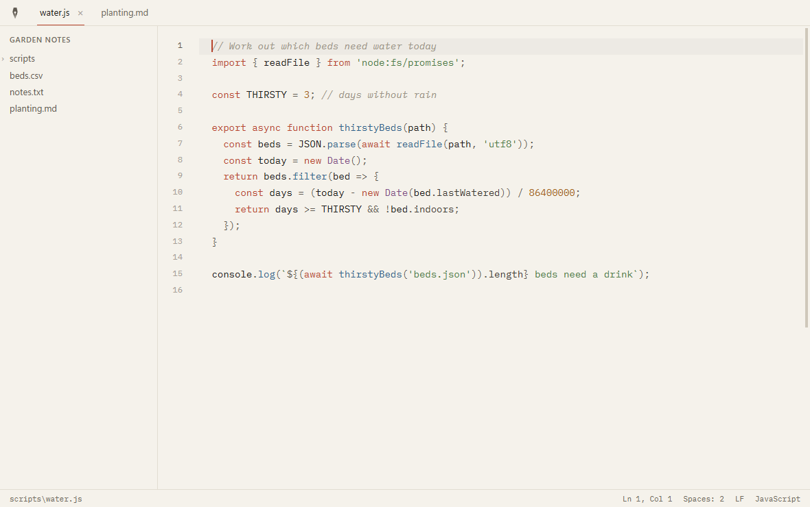
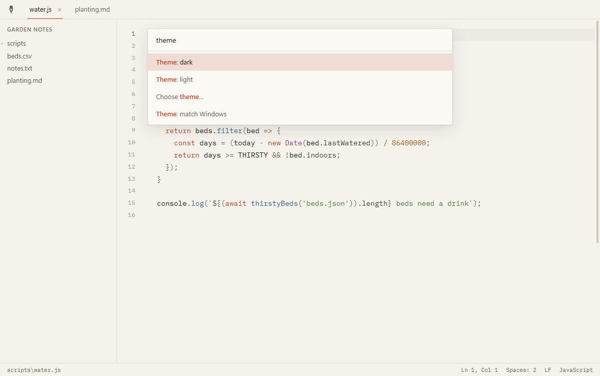
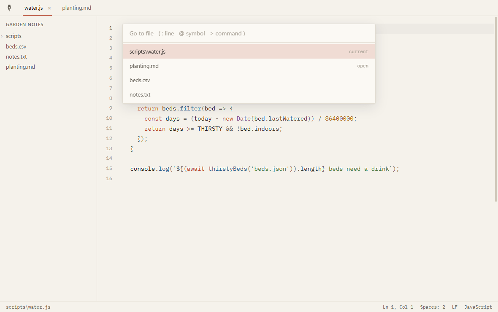
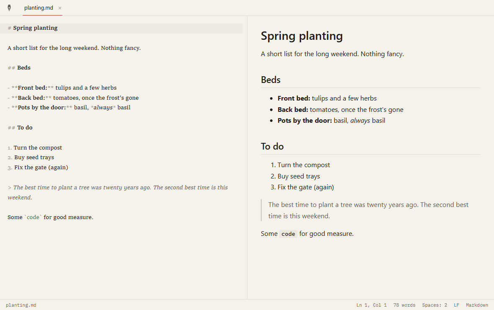
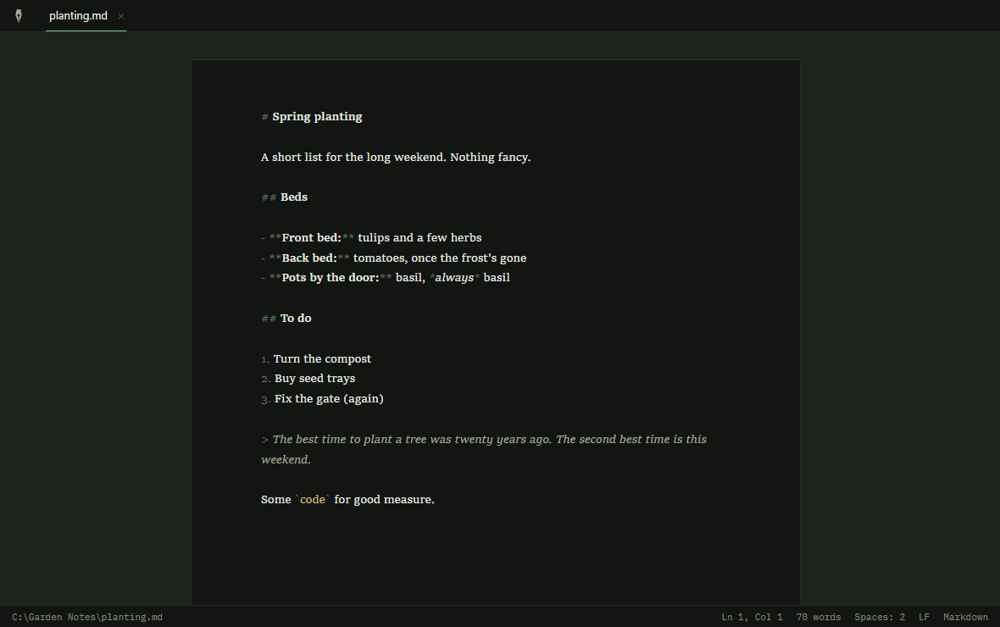
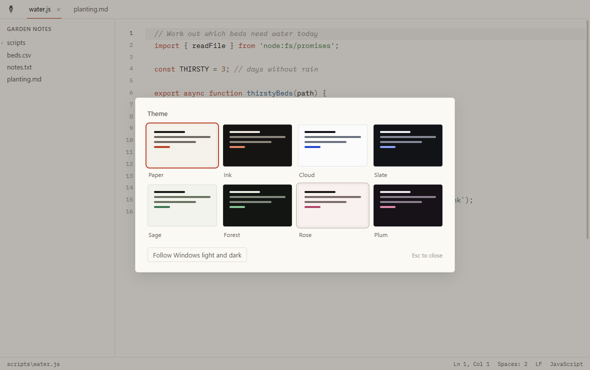
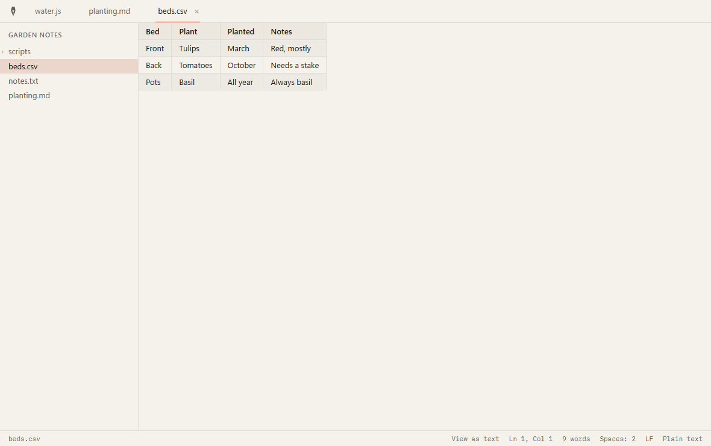

<p align="center">
  <picture>
    <source media="(prefers-color-scheme: dark)" srcset="docs/logo-dark.svg">
    
  </picture>
</p>

<h1 align="center">Recto</h1>

<p align="center">A small, quiet text editor for Windows.<br>
It opens fast, stays out of the way, and doesn't ask you to sign in to anything.</p>

<p align="center">
  <a href="https://github.com/DanBierre/recto/releases/latest/download/Recto-Setup.exe"><strong>Download Recto for Windows</strong></a><br>
  <sub>Windows 10 or 11, 64-bit &middot; about 100 MB &middot; free</sub><br>
  <sub><a href="https://softlightsoftware.dev/recto.html">More on the Recto page</a></sub>
</p>

<p align="center">
  <picture>
    <source media="(prefers-color-scheme: dark)" srcset="docs/screenshots/editor-dark.png">
    
  </picture>
</p>

I built it because I wanted something between Notepad and Sublime: quick enough to open a log file, good enough to write code in.

*Recto* is the right-hand page of an open book. It's the page you start writing on.

## Get it

1. [Download `Recto-Setup.exe`](https://github.com/DanBierre/recto/releases/latest/download/Recto-Setup.exe).
2. Run it.
3. If Windows shows **Windows protected your PC**, click **More info**, then **Run anyway**.

That warning is there because the installer isn't signed yet. The source is all in this repo, so you can read it or build the installer yourself (see below) if you'd rather not take my word for it.

Recto is free and [MIT licensed](LICENSE).

## A look around

<table>
  <tr>
    <td width="50%"><br><sub><b>Command palette.</b> <code>Ctrl+Shift+P</code>. Every setting lives here too.</sub></td>
    <td width="50%"><br><sub><b>Go to file.</b> <code>Ctrl+P</code>. Start with <code>:</code>, <code>@</code> or <code>&gt;</code> for a line, a symbol or a command.</sub></td>
  </tr>
  <tr>
    <td><br><sub><b>Markdown preview.</b> <code>Ctrl+Shift+M</code>.</sub></td>
    <td><br><sub><b>Page layout.</b> A centred sheet, nice for writing.</sub></td>
  </tr>
  <tr>
    <td><br><sub><b>Eight themes.</b> Or follow Windows light and dark.</sub></td>
    <td><br><sub><b>CSV as a table.</b> Switch to the raw text any time.</sub></td>
  </tr>
</table>

The first time it runs, Recto asks a few quick questions (theme, layout, font, right-click menu, desktop shortcut). You can skip them, and change any of it later.

## What it does

- Tabs that come back after a restart, unsaved ones included
- Syntax highlighting for the usual languages
- Go to file, go to line, go to symbol and a command palette
- Find and replace, plus find in files across an open folder
- Multiple cursors, column select, move and duplicate lines
- Markdown preview
- Split view: a read-only copy of any tab beside the one you're typing in
- Pin a tab to keep it at the left and safe from a stray close
- Word and character counts, and a Wrap button in the status bar
- Recent files and recent folders on the welcome screen
- Line tools in the palette: sort, tidy spaces, change case
- Print, or export to PDF, a web page, a Word document or plain text (`Ctrl+Shift+E`)
- Turn a CSV into JSON and back again, each into a new tab
- Opens more than text: pictures and PDFs to look at, CSV files as a table, and the words out of Word files
- Eight themes to pick from: Paper, Ink, Cloud, Slate, Sage, Forest, Rose and Plum, or follow Windows light and dark
- Three layouts: Classic, Page (a centred sheet, nice for writing) and Focus
- Pick your own fonts from the palette (`Font: choose…`): one for notes, one for code. It only lists fonts installed on your computer, shows each in its own style, and previews as you move
- Keeps your file's encoding (UTF-8, UTF-16, Windows-1252) and line endings (Windows or Unix) as they were. A file with a mix of the two gets tidied to one style, and Recto tells you when it opens
- Can start with a blank page instead of your last files, if you'd rather
- "Edit with Recto" in the Explorer right-click menu

## Why Recto

Most of these came from people's gripes about the editors they already use. Recto just doesn't do the annoying bit.

- **No AI, no account.** It's a text editor. There's nothing to sign in to and nothing trying to finish your sentences.
- **No licence pop-ups or update nags.** It's free, and it won't interrupt you to say so.
- **Sends nothing on its own.** No telemetry, no crash reports, no background update checks. The one exception is "Check for updates", which only runs when you pick it and only asks GitHub for the latest version number. Your words stay on your computer.
- **Quiet notes instead of pop-ups.** Saved, exported, reloaded: a small note shows in the corner and fades. Nothing to click away.
- **No clutter.** No toolbars, no ribbon, no minimap. Focus mode (`F11`) hides the rest too.
- **Settings live in the command palette.** Type what you want to change. No settings page to dig through.
- **Reloads saved files quietly.** If another program changes a file you haven't touched, Recto just shows the new version. If you've got unsaved edits, it keeps them and lets you know, so you choose.
- **Unsaved tabs come back.** Close it, restart Windows, whatever. Your drafts are there next time.
- **Opening a file twice goes to the tab you've already got.** No second copy to get confused by.
- **No preview tabs.** A file you open stays open until you close it.
- **Opens in about three-quarters of a second.** Measured on a normal laptop, cold start to cursor.

## Shortcuts

| Keys | Does |
| --- | --- |
| `Ctrl+P` | Go to file |
| `Ctrl+Shift+P` | Command palette |
| `Ctrl+G` / `Ctrl+R` | Go to line / symbol |
| `Ctrl+F` / `Ctrl+H` | Find / replace |
| `Ctrl+Shift+F` | Find in files |
| `Ctrl+D` | Select next match |
| `Ctrl+Shift+L` | Cursor on each selected line |
| `Ctrl+Shift+D` | Duplicate line |
| `Ctrl+Shift+K` | Delete line |
| `Ctrl+/` | Toggle comment |
| `Ctrl+Shift+T` | Reopen closed tab |
| `Ctrl+B` | Sidebar |
| `Ctrl+Shift+M` | Markdown preview |
| `F11` | Focus mode |
| `Ctrl+Shift+E` | Export or print |
| `Alt+Z` | Word wrap |

The command palette lists the rest.

## Build it yourself

You need [Node.js](https://nodejs.org) 20 or newer.

```bash
npm install
npm start
```

To make the Windows installer:

```bash
npm run dist
```

The installer ends up in `release/`. It installs for your user only, so it doesn't need admin rights.

To run the tests:

```bash
npm test
npm run check
```

## Built with

[Electron](https://www.electronjs.org) and [CodeMirror 6](https://codemirror.net).

## A bit of history

I built Recto last year for myself and kept it private. It's been my everyday editor since, so it felt like time to put it out there.

## Contributing

Contributions are very welcome, big or small.

One spot that could really use a hand: the setup window in [`build/setup.cs`](build/setup.cs). It's C#, and I'm not the best at C#, so some of it is probably up to interpretation. If you know your way around WinForms and spot something odd, a pull request or an issue would be much appreciated.

## Licence

MIT. See [LICENSE](LICENSE).
